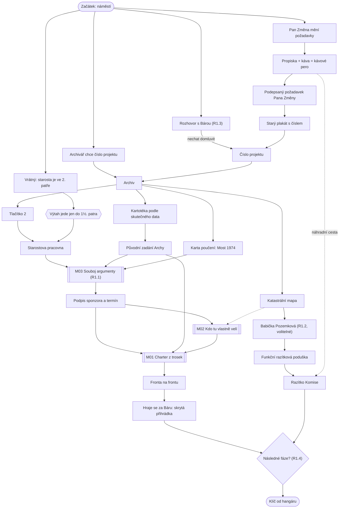

# Kapitola 1: Iniciace (vertical slice)

> Podrobný návrh kapitoly 1. Je to první hratelná část hry: ověří zábavnost, humor, minihry,
> rozhodnutí s pozdějším následkem, hraní za Báru i rychlost výroby.
> Stav: **koncept**, verze 0.2

## Přehled

| | |
|---|---|
| **Délka** | 40–60 minut (krátký úvod 3–5 min + kapitola) |
| **Cíl hráče** | získat podepsaný a orazítkovaný projektový charter, jinak Komise nevydá klíč od hangáru s Archou |
| **Výuková témata** | V02 business case, V03 charter, V04 stakeholdeři, V05 komunikace, V22 poučení z minulosti ([matice](../02-vyukova-matice.md)) |
| **Minihry** | M01 Charter z trosek, M02 Kdo tu vlastně velí, M03 Souboj argumenty ([minihry](../04-minihry.md)) |
| **Rozhodnutí** | R1.1 slib, R1.2 babička, R1.3 Bára, R1.4 „fáze 2“ |
| **Hraní za Báru** | ano, krátký úsek v archivu |
| **Kometa** | malá, sotva viditelná tečka s ocasem |

## Místo v koncepci Dva světy, jedna Archa

Kapitola 1 je **společný základ** ([koncepce](../07-dva-svety.md)): proč, pro koho a kdo
rozhoduje platí pro celou Archu bez ohledu na to, jak se pak která část bude stavět. Oba světy
se tu ale poprvé ukážou v postavách a kapitola zasévá rozdělení Archy pro kapitolu 2:
- **Ruda a Bára se poprvé střetnou:** on slibuje, ona měří (R1.3).
- **Původní zadání Archy** v archivu má dvě části, které se liší: „Rampa a trup: výkresy hotové,
  schváleno 1994.“ a „Řídicí systém a kajuty: dopracuje se podle potřeb obyvatel.“
- **Ing. Framework** se mihne ve frontě na frontu a nabízí „agilní frontu“.
- Vertical slice rozdíl mezi světy ještě netestuje. Proto po něm hned následuje papírový
  prototyp dvojice M13 Jeřábový balet a M14 Ukázka na náměstí ([minihry](../04-minihry.md)).

Výuka zůstává skrytá: nikdo ve hře neřekne „charter“, „stakeholder“ ani „business case“.
Ruda prostě potřebuje papír, bez kterého ho Komise nepustí dál, a zjistí, že ten papír má smysl
jen tehdy, když ví, proč a pro koho se Archa staví.

## Výchozí stav

Z úvodu má Ruda v inventáři:
- **jmenovací dekret** politý kávou (číslo projektu je nečitelné),
- **hrnek kávy** (nekonečný, Ruda bez kávy nefunguje),
- **propisku bez inkoustu**,
- **Prof. Pemboka**, mluvící knihu, kterou dostal k narozeninám a nikdy neotevřel (nápověda).

## Scény

| # | Scéna | Postavy | Co se tu děje |
|---|---|---|---|
| S1 | **Náměstí před radnicí** (rozcestí) | Bára, Pan Změna, vrátný | úvodní rozhovory, stánek Pana Změny, Bára u kašny |
| S2 | **Vestibul radnice** | vrátný | výtah jezdí jen do 1½. patra, schody jsou „ve fázi 2“ |
| S3 | **Archiv zkrachovalých projektů** (sklep) | archivář Lumír | nekonečné regály, kartotéka, skrytá přihrádka |
| S4 | **Starostova pracovna** (2. patro) | starosta Bohumil | souboj argumenty, podpis sponzora |
| S5 | **Kancelář Komise** (1½. patro) | Předseda Věčný, fronta úředníků | fronta na frontu, charter, razítko |
| S6 | **Babiččina chaloupka** pod rampou (volitelná) | babička Pozemková, kocour | jediná dokončená stavba ve městě |

Nová vedlejší postava: **archivář Lumír**, monotónní muž, který katalogizuje každý zkrachovalý
projekt a je na to tiše hrdý. Jako jediný ve městě něco opravdu dokončuje: kartotéční lístky.

## Průběh a puzzly

1. **Úvodní úkol.** Pembok (poprvé otevřený) Rudovi vysvětlí, že bez podepsaného papíru od sponzora
   a razítka Komise nedostane klíč od hangáru. Ruda: „Papír? Za mě mluví výsledky!“ Pembok: „Které?“
2. **Kdo je sponzor?** Dekret podepsal „zástupce zástupce starosty“. Vrátný prozradí, že
   o Arše rozhoduje starosta Bohumil ve 2. patře. Výtah ale jezdí jen do 1½. patra.
3. **Archiv.** Archivář Lumír pustí dovnitř jen s číslem projektu. Číslo na dekretu je pod kávou.
   Dvě cesty:
   - **Bára** zná číslo nazpaměť (byla v původním týmu Archy). Řekne ho ale jen tehdy, když ji
     Ruda při prvním rozhovoru nechá domluvit (**R1.3**).
   - **Pan Změna** balí zboží do starého plakátu Archy s číslem projektu. Plakát vydá výměnou
     za jednu věc, ale co chce, se mění při každém rozhovoru. Řešení: **propiska + káva =
     kávové pero**, jeho požadavek zapsat a nechat ho podepsat. S podepsaným požadavkem
     přestane měnit názor. (Zárodek tématu řízení změn pro kapitolu 3.)
4. **V archivu** najde Ruda:
   - **tlačítko „2“** do výtahu v krabici projektu *Modernizace výtahu (1987–dosud)*;
   - **původní zadání Archy**. Kartotéka je seřazená podle plánovaného dokončení a na každém
     lístku stojí „příští rok“. Kdo seřadí lístky podle skutečného data zahájení z Lumírovy
     knihy, zadání najde. Zadání říká: Archa má odvézt **všechny** obyvatele. Rampa a trup
     mají hotové výkresy, řídicí systém a kajuty se mají „dopracovat podle potřeb obyvatel“
     (zárodek rozdělení Archy v kap. 2);
   - **kartu poučení** *Most přes řeku (1974): Zapomněli jsme se zeptat rybářů.*;
   - **katastrální mapu**, podle které pozemek pod rampou patří někomu jménem Pozemková.
5. **Starosta.** Tlačítko „2“ zapojené do výtahu ho dopraví ke starostovi. Starosta chce „něco,
   co bude v novinách“. Následuje **M03 Souboj argumenty**. Repliky se sbírají z původního
   zadání, z karty poučení a z Bářiných výpočtů. Kdo prohraje, může se vrátit s lepšími replikami.
   Kdo chce vyhrát hned, může všechno slíbit (**R1.1**).
6. **Podpis sponzora.** Starosta podepíše, určí termín (30 dní) a pošle Rudu na Komisi.
7. **M02 Kdo tu vlastně velí.** Před Komisí si Ruda (na Pembokovu radu) nakreslí, kdo o čem
   rozhoduje. Babičku lze správně umístit jen s katastrální mapou nebo po rozhovoru s jejím kocourem.
8. **Babička Pozemková** (volitelné, **R1.2**). Pozemek pod rampou je její a nikdo se jí nikdy
   na nic nezeptal. Kdo ji vyslechne, získá spojence a **funkční razítkovou podušku**
   (Komisi už dávno vyschla).
9. **M01 Charter z trosek** v kanceláři Komise. Útržky má hráč z celé kapitoly: termín od starosty,
   cíl z původního zadání, kritéria úspěchu od Báry (jen když ji poslouchal), nesmysly od Pana
   Změny a od Předsedy.
10. **Fronta na frontu.** Ruda musí čekat ve frontě, aby se mohl postavit do fronty. Ve frontě
    stojí i **Ing. Framework** a nabízí „agilní frontu“: stejná fronta, ale každé dva týdny se
    jí říká jinak. Mezitím se **hraje za Báru** (viz níže).
11. **Předseda Věčný** charter orazítkuje. Bez babiččiny podušky jen kávovým perem: razítko je
    hnědé a rozmazané, platí, ale Předseda se mračí. Na závěr chce do charteru připsat
    „a následné fáze“ (**R1.4**).
12. **Konec kapitoly.** Ruda dostane klíč od hangáru. Kometa je o kousek větší. Předseda v kanceláři
    telefonuje: „Ano, pustil jsem ho dál. Nebojte se. V tomhle městě se nikdy nic nedokončí.“
    (Pozor: tahle scéna prozrazuje Předsedu. Upravit podle rozhodnutí, zda je záporák od začátku,
    nebo zvrat.)

## Hraní za Báru: skrytá přihrádka

- **Kdy:** zatímco Ruda stojí ve frontě na frontu.
- **Proč:** Bára se vrátí do archivu ověřit, kolik lidí má Archa uvézt. Nevěří odhadům, chce čísla.
- **Jak hraje jinak než Ruda:** Ruda blafuje a kombinuje nesmysly, Bára měří a ověřuje.
  Puzzle: regál je zvenku hlubší než zevnitř. Kdo ho změří metrem, najde skrytou přihrádku.
- **Co najde:** třicet let starý **seznam pasažérů Archy**: jen členové Komise a jejich rodiny.
- **Následek:** Bára si seznam nechá. Jestli ho Rudovi ukáže, rozhodne její důvěra
  v kapitolách 3–4. Hráč ví víc než Ruda, a to drží napětí.

## Rozhodnutí kapitoly

| ID | Kde | Volby | Příznak (flag) | Kde se vrátí |
|---|---|---|---|---|
| R1.1 | souboj se starostou | realistický charter / slíbit všechno (rozsah, termín i rozpočet) | `c1_slib_vseho` | kap. 4: sponzor trvá na všem, krize je tvrdší |
| R1.2 | babička | vyslechnout / nenavštívit / neodhalit | `c1_babicka` = `spojenec` / `prehlizena` | kap. 4: zablokovaná rampa |
| R1.3 | první rozhovor s Bárou | nechat domluvit / skočit do řeči | `c1_bara_vyslechnuta` (počet), Bářina důvěra | kap. 3: Bára mlčí o vadě softwaru |
| R1.4 | Předseda a „následné fáze“ | odmítnout s odkazem na rozsah / přijmout | `c1_faze2` | kap. 3: Předseda má páku na nekonečné změny |

Další příznaky: `c1_charter_kvalita` (0–3), `c1_razitko` = `poduska` / `kava`,
`c1_seznam_pasazeru` (Bára má seznam), `c1_zmena_dohoda` (Pan Změna podepsal požadavek).

## Graf závislostí puzzlů

Plné šipky jsou nutné kroky, tečkované jsou náhradní nebo volitelné cesty. Úzká místa: archiv
(dvě cesty dovnitř), starosta a charter.

## Minihry v kapitole 1

### M01 Charter z trosek: útržky

| Kolonka | Dobrý útržek | Nesmysl nebo past | Odkud |
|---|---|---|---|
| Cíl | CS: *Odvézt všechny obyvatele do bezpečí před dopadem komety.* EN: *Get every resident to safety before the comet hits.* | CS: *Aby to bylo hezký.* EN: *Make it look nice.* | zadání / Pan Změna |
| Termín | CS: *Start nejpozději 30. den.* EN: *Launch by day 30 at the latest.* | CS: *Až to bude.* EN: *When it's done.* | starosta / Předseda |
| Kritéria úspěchu | CS: *Archa unese 4 812 lidí a vzlétne.* EN: *The Ark carries 4,812 people and actually lifts off.* | CS: *Všichni budou spokojení.* EN: *Everyone will be happy.* | Bára / Pan Změna |
| Mimo rozsah | CS: *Bazén, vyhlídková terasa, fontána.* EN: *Pool, observation deck, fountain.* | CS: *Nic, všechno je v rozsahu.* EN: *Nothing. Everything's in scope.* | Bára / Ruda |
| Kdo rozhoduje | CS: *Starosta Bohumil.* EN: *Mayor Bohumil.* | CS: *Komise pro schvalování komisí, pokud schválí.* EN: *The Committee for Approving Committees, pending approval.* | podpis / Předseda |
| Navíc | – | CS: *…a následné fáze.* EN: *…and subsequent phases.* | Předseda (R1.4) |

`c1_charter_kvalita` = počet kolonek se správným útržkem (cíl, termín, kritéria), 0–3.

### M02 Kdo tu vlastně velí: postavy na mapě

| Postava | Vliv | Zájem | Jak to hráč pozná |
|---|---|---|---|
| Starosta Bohumil | vysoký | střední | podepisuje, ale zajímají ho hlavně noviny |
| Předseda Věčný | vysoký | vysoký | všechno musí přes něj |
| Babička Pozemková | vysoký (pozemek) | nízký (zatím) | katastrální mapa nebo kocour |
| Pan Změna | nízký | vysoký | mluví do všeho |
| Bára | nízký (zatím) | vysoký | ví nejvíc, nikdo se jí neptá |
| Obyvatelé (vrátný, archivář) | nízký | vysoký | Archa je má odvézt |

### M03 Souboj argumenty se starostou: ukázková kola

| Námitka starosty | Dobrá replika | Rychlá, ale nebezpečná replika |
|---|---|---|
| CS: *Lidi chtějí výsledky, ne papíry!* EN: *People want results, not paperwork!* | CS: *Proto na jeden papír napíšeme, jaký výsledek chtějí.* EN: *Exactly. So let's write down, on one page, what result they actually want.* | CS: *Výsledky budou do pátku.* EN: *You'll have results by Friday.* |
| CS: *Archa musí být největší v kraji!* EN: *The Ark must be the biggest in the region!* | CS: *Podle původního zadání má odvézt všechny obyvatele. Velikost z toho vyplyne.* EN: *The original brief says it has to carry everyone. The size follows from that.* (z archivu) | CS: *Bude největší na světě.* EN: *It'll be the biggest in the world.* |
| CS: *Minule to taky nevyšlo.* EN: *It didn't work last time either.* | CS: *Minule se nikdo nezeptal rybářů. My se zeptáme.* EN: *Last time nobody asked the fishermen. We will.* (karta poučení) | CS: *Minule jsem tu nebyl já.* EN: *Last time you didn't have me.* |
| CS: *Kdo za to ponese odpovědnost?* EN: *Who's going to take responsibility?* | CS: *Vy za to proč, já za to jak.* EN: *You own the why. I own the how.* | CS: *Já za všechno!* EN: *Me. For everything!* |

Rychlé repliky vyhrají kolo, ale každá zvyšuje `c1_slib_vseho`. Tři rychlé repliky = R1.1 „slíbit všechno“.

## Ukázkové dialogy

Formát odpovídá tabulce řetězců z [produkčních zásad](../05-produkce.md): stabilní ID, mluvčí,
emoce, oba jazyky. Vtipy jsou psané pro každý jazyk zvlášť, ne přeložené.

| ID | Mluvčí | Emoce | CS | EN |
|---|---|---|---|---|
| `ch1_ruda_001` | Ruda | sebevědomě | Nedostavěnice. Město neomezených možností. Hlavně proto, že žádnou z nich nikdo nedotáhl. | Unfinishedton. A city of endless possibilities. Mostly because nobody ever finished one. |
| `ch1_ruda_002` | Ruda | odhodlaně | Mám plán. Teda, budu mít plán. Mám plán, že budu mít plán. | I have a plan. Well, I'll have a plan. I plan to have a plan. |
| `ch1_ruda_010` | Ruda | pohled na výtah | Výtah do půl patra. Konečně stavba, která přiznává, jak na tom je. | An elevator that only goes halfway. Finally, a building that's honest about its progress. |
| `ch1_pembok_001` | Pembok | ironicky | Než začneš stavět Archu, nebylo by dobré vědět, proč ji stavíš? Čistě teoreticky. | Before you build an Ark, might it help to know why? Purely hypothetically. |
| `ch1_bara_001` | Bára | věcně | Ta rampa má sklon o tři stupně větší, než stojí ve výkres— | That ramp is tilted three degrees more than the drawings sa— |
| `ch1_ruda_020` | Ruda | skáče do řeči | Výborně, poznamenám si to. *(píše do vzduchu propiskou bez inkoustu)* | Brilliant, I'll make a note. *(writes in the air with an empty pen)* |
| `ch1_zmena_001` | Pan Změna | nadšeně | Chci Archu. Modrou. Ne, zelenou. S bazénem. Bez vody, kvůli bezpečnosti. | I want an Ark. Blue. No, green. With a pool. No water, for safety reasons. |
| `ch1_zmena_002` | Pan Změna | po podpisu, zmateně | Já… to jsem podepsal? Tak to asi opravdu chci. Zvláštní pocit. | I… signed that? Then I suppose I really want it. What a strange feeling. |
| `ch1_lumir_001` | archivář Lumír | monotónně | Vítejte v archivu. Máme tu všechny projekty, které kdy v Nedostavěnici začaly. Tedy všechny projekty. | Welcome to the archive. We keep every project ever started in Unfinishedton. Which is every project. |
| `ch1_lumir_002` | archivář Lumír | hrdě | Tenhle lístek jsem dokončil v roce 1998. Dodnes ho mám rád. | I completed this index card in 1998. I'm still rather fond of it. |
| `ch1_predseda_001` | Předseda | vlídně | Váš návrh je vynikající. Právě proto ho musíme důkladně odložit. | Your proposal is excellent. Which is precisely why it must be thoroughly postponed. |
| `ch1_predseda_002` | Předseda | nad kávovým razítkem | Hnědé razítko. Platné. Bohužel. | A brown stamp. Valid. Regrettably. |
| `ch1_babicka_001` | babička Pozemková | suše | Mladej, můj dům tu stojí šedesát let. Jediná dokončená stavba ve městě. Proto se mnou nikdo nemluví – nevědí, co se s hotovou věcí dělá. | Young man, my house has stood here for sixty years. The only finished building in town. That's why nobody talks to me. They don't know how to handle closure. |
| `ch1_ruda_090` | Ruda | ve frontě | Fronta na frontu. Kdyby tohle šlo exportovat, byli bychom nejbohatší město na světě. | A queue for the queue. If we could export this, we'd be the richest city on earth. |
| `ch1_framework_001` | Ing. Framework | obchodnicky | Agilní fronta! Pořád stejná fronta, ale každé dva týdny jí říkáme jinak. Zvýší to morálku čekajících o čtyřicet procent. | The agile queue! Same queue, but every two weeks we give it a new name. Boosts waiting-room morale by forty percent. |
| `ch1_ruda_091` | Ruda | podezíravě | A kdo to změřil? | And who measured that? |
| `ch1_framework_002` | Ing. Framework | uraženě | Měřit? To je strašně vodopádové. | Measured? How terribly waterfall of you. |
| `ch1_ui_komise_cedule` | cedule | – | Komise pro schvalování komisí. Úřední hodiny: příští fáze. | Committee for Approving Committees. Office hours: next phase. |

## Rozsah výroby (odhad)

| Položka | Počet |
|---|---|
| Pozadí scén | 6 (+ úvod) |
| Postavy s referenčním listem | 9 (Ruda, Bára, Předseda, starosta, Pan Změna, Lumír, babička, vrátný, Ing. Framework) + kocour |
| Předměty v inventáři | cca 15 |
| Minihry | 3 |
| Repliky | cca 350–450 na jazyk |
| Hratelný úsek za Báru | 1 |

## Otevřené otázky

- [ ] Předseda: zachovat závěrečný telefonát (prozrazuje ho), nebo ho zamlžit kvůli zvratu?
- [ ] Číslo 4 812 obyvatel: běžecký vtip, nebo jen číslo?
- [ ] Je cesta přes Pana Změnu dost zábavná, aby nebyla trestem za neposlouchání Báry?
- [ ] Úvod (3–5 min) rozepsat zvlášť, nebo jako součást této kapitoly?
